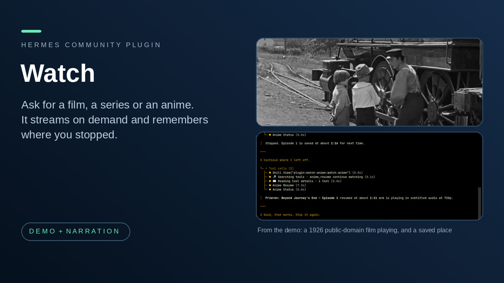

# Watch



Ask Hermes for a show or a film and it streams it on demand, with nothing to download first, and remembers where you stopped. Anime, movies and TV series.

**Who it is for:** someone who runs Hermes on a Linux computer with mpv and wants to say "play the next episode" or "continue my film" instead of hunting for links.

It is the same idea with two sources: find it, stream it, resume it.

| Part | What it is for | Tools |
|---|---|---|
| Anime | Find an anime, pick the exact season, choose an episode, play it in mpv, continue where you stopped. Uses ani-cli's provider code, pinned. | `anime_search`, `anime_episodes`, `anime_play`, `anime_status`, `anime_control`, `anime_history`, `anime_resume` |
| Movies and TV | Search films and series by title and year, pick the exact title and episode, play it in mpv, continue even if the source changes. Uses Luffy through a small bridge you build yourself from the source in `movies/native/`. | `movies_search`, `movies_details`, `movies_play`, `movies_status`, `movies_control`, `movies_history`, `movies_resume` |

**Install and enable**

```
hermes plugins install flabanabba8/watch
hermes plugins enable watch
```

Restart Hermes after enabling. Then ask, for example: "Search for Frieren", "Play episode 1, subtitled, at 720p", "Pause it", "Continue watching", "Search for the film Metropolis (1927)".

**What it needs**

- Hermes 0.22 or later, on Linux (the only platform verified), with mpv installed. Python 3.11 or later and a POSIX `sh`. No Python packages to install.
- Anime: nothing else. No account, login or key.
- Movies and TV: a bridge you build with `sh movies/native/build-bridge.sh /absolute/new-output-directory` (needs Git and Go 1.26 or later), then set `bridge_path` and `bridge_sha256` in the plugin settings to the path and the SHA-256 the build prints. A bridge built without Luffy's own key needs your own TMDB API v3 key in the `tmdb_api_key` setting (Hermes stores it as a secret).

**What it calls on the internet**

- Anime: the streaming site `hianime.at` (search, episode and server lists), then the embed and media hosts it points to for the episode you chose.
- Movies and TV: TMDB (`api.themoviedb.org`) for search and details; the streaming sites Cinejoy, VixSrc and LookMovie, and the embed, subtitle and media hosts they point to, to resolve a stream; the upstream Luffy engine may fetch its own pinned encoder, and its integrity check is left in place. `build-bridge.sh`, which you run yourself and the plugin never runs, fetches the pinned Luffy source from GitHub.
- mpv then streams the video and subtitles directly from those hosts. Nothing is bundled, hosted or downloaded for offline viewing. No telemetry, update check or self-updater.

**Limits**

- Linux only. On other systems the tools say so before contacting anything.
- The streaming sites serve third-party content. The plugin cannot check its licensing; that is your call and your responsibility. Use sources you are allowed to access. Site changes can break search or playback, and a listing is not a guarantee that a stream plays.
- The player opens on the computer running Hermes, also when the request comes from a messaging app. Only start it when you ask for playback.
- Left out of this combined plugin: the Desktop page and dashboard routes that the two stand-alone plugins have. They were two separate surfaces that do not fit into one plugin without new code, so they are not shipped here. Everything works through chat.
- A bridge built from unmodified upstream Luffy falls back to Luffy's own built-in TMDB key when you set none (that key is not in this repository and its owner may limit or revoke it). A bridge built without it needs your key. TMDB's approved logo is not integrated and its commercial-use terms are not settled.
- Short live tests are not a full-length playback or uptime guarantee. See `VERIFICATION.md`.

## How it is built

One plugin, `watch`. `__init__.py` registers the two parts in `anime/` and `movies/`, each the stand-alone plugin's code with its behaviour, tool names and approval rules unchanged (there are no hooks, middleware or commands, and no approval hook; playback only starts when you ask). Each part keeps its own skill (`watch-anime`, `watch-movies`) and its own wiki. `llmwiki/index.md` is the suite entry and links both. Watch history, progress and session receipts are stored in separate folders under the plugin's data folder: `plugin-data/watch/anime/` and `plugin-data/watch/movies/`. They are separate from the data of the stand-alone watch-anime and watch-movies plugins and are not migrated from them.

Run the tests from this folder: `python3 -m unittest discover -s tests -v`.

## Credits and licences

Licence: GPL-3.0-only (see `LICENSE`).

- ani-cli by pystardust and contributors: the anime provider code in `anime/vendor/provider.sh` is derived from it, at the exact commit and file hash recorded in `anime/UPSTREAM.json`. Search, episode listing and stream resolution are kept; menus, downloads, updates and history writes are removed.
- Luffy by DemonKingSwarn: the movies bridge is built from the pinned revision recorded in `movies/UPSTREAM.json`, with a small change to the TMDB key constant so your own key can override it, plus the included provider overlay. AniDroid's JSON bridge source and a fallback derived from MADPANDA3D/pandaflix are retained with their attribution (`movies/UPSTREAM.json`).
- mpv does the playback.
- TMDB: this product uses the TMDB API but is not endorsed or certified by TMDB.
- Independent community software, not affiliated with Nous Research, ani-cli, Luffy, TMDB, the streaming sites or any rights holder.

**AI assistance:** written with AI coding assistants (Anthropic Claude and OpenAI Codex agents) under the maintainer's direction. What was actually tested is in `VERIFICATION.md`.
